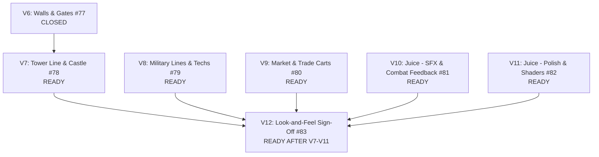

# Game Completion Specification: Map #69 (V6–V12)

> **Document Class:** Research & Specification Artifact  
> **Status:** ACTIVE / SPECIFIED  
> **Related Epics:** GitHub Issue [#69](https://github.com/jamesm944/game/issues/69) (*Wayfinder map 2: AoE2 look & feel — finish the game*), Issue [#71](https://github.com/jamesm944/game/issues/71) (*Decide content breadth & juice inventory*)  
> **Branch Target:** `main`

---

## 1. Executive Summary & Context

This document establishes the authoritative technical blueprint to bring **Ageofwind** from its current functional milestone state (M5) to a fully completed, polished, commercial-grade Age of Empires II-style browser RTS.

### 1.1 Primary Sources Cited
1. **Repository Specifications**:
   - `SPEC.md`: §2 (Simulation & Game Rules), §2.5 (Combat & Counters), §2.6 (Economy), §2.9 (Fog of War), §2.10 (Audio Architecture), §2.11 (Ages & Victory), §2.13 (Controls & UX), §2.14 (Visual Style & Performance), §3 (Entity Definitions & Load Disciplines), §6 (Asset Sources & Licensing), §7 (Performance Budgets & State Hash Contracts), §8 (Milestones & Demo Checklist).
   - `CONTEXT.md`: System architecture, ECS component index, tick boundary rules, deterministic math.
   - `docs/adr/`: ADR-0001 (Deterministic ECS), ADR-0002 (Tile Grid World), ADR-0003 (Unit Movement & Pathfinding), ADR-0004 (Threading Model).
2. **Asset & Content Inventories**:
   - `ASSET-INVENTORY.md`: 11 CC0 3D asset packs acquired on `research/asset-packs` (~250 GLTFs, 128 UFRS building models, 9 humanoid rigs, ~40 accessories).
   - `src/assets/audio/MANIFEST.md`: 13-clip CC0 audio manifest mapped to Kenney and OpenGameArt packages.
3. **Decisions & Issues**:
   - Issue [#70](https://github.com/jamesm944/game/issues/70): CC0 3D Pack acquisition & inventory.
   - Issue [#71](https://github.com/jamesm944/game/issues/71): Content breadth & juice priority ranking.
   - Issues [#77]–[#83]: Deliverable milestone issues V6 through V12.

---

## 2. Completed Preparatory Tasks (Status Check)

The following preparatory work has been implemented and validated directly in the active codebase to unblock implementation agents:

1. **V6 (Walls & Gates — Issue [#77](https://github.com/jamesm944/game/issues/77)) Completed & Closed**:
   - Palisade wall, Stone wall, Palisade gate, and Stone gate definitions authored in `src/data/definitions/buildings/`.
   - Bresenham `traceWallRun` implemented in `src/sim/systems/placement.ts` for contiguous drag-placement.
   - Asymmetric passability (`passabilityForPlayer`) implemented in `src/sim/systems/placement.ts` and `src/sim/systems/movement.ts` (gates passable for owner, impassable for enemies).
   - Dynamic repathing on wall placement verified via `passabilityVersion` invalidation.
   - Quaternius UFRS 3D models hooked in `src/render/buildingModels.ts`.
   - Full test suite passing in `tests/walls-and-gates.test.ts`. Issue [#77] committed (`6ecc9c6`) and closed.

2. **Def Codes Canon Guard (`src/data/definitions.ts`)**:
   - Implemented `assignCanonicalCodes` with `CANONICAL_UNIT_IDS`, `CANONICAL_BUILDING_IDS`, and `CANONICAL_TECH_IDS`.
   - Guaranteed that adding any new military units, buildings, or branch technologies will **never** alter the numeric u8 codes of the canonical initial entities (Units 1..8, Buildings 1..25, Techs 1..8).
   - Golden replay harnesses (`m5t3-replay`, `m2t10a`, `m4t5a`) maintain 100% byte-for-byte digest parity.

3. **Core Schema Extensions (`src/data/schema.ts`)**:
   - Added optional defensive combat fields to `buildingSchema`:
     ```typescript
     attack: z.number().int().nonnegative().optional(),
     range: z.number().positive().optional(),
     reloadTicks: z.number().int().positive().optional(),
     ```
   - Enabled defensive structures (towers, castles) to declare attacks natively in JSON definitions without ad-hoc engine hacks.

4. **Pre-Scaffolded Definitions Loaded & Validated**:
   - **V7 Buildings**: `castle.json` (4x4 footprint, 4800 HP, Castle Age, 11 attack, 8 range, 60 reload ticks); `watch-tower.json` updated with 5 attack, 8 range, 60 reload ticks.
   - **V9 Buildings & Units**: `market.json` (4x4 footprint, 1800 HP, Feudal Age, trainable `trade-cart`); `trade-cart.json` (100w 50g, 70 HP, speed 1.0).
   - **V8 Units**: `longswordsman.json`, `two-handed-swordsman.json`, `arbalest.json`, `light-cavalry.json`, `cavalier.json`, `paladin.json`.
   - **V8 Technologies**: 13 branch techs authored in `src/data/definitions/techs/` (`iron-casting`, `blast-furnace`, `chain-mail`, `plate-mail`, `scale-barding`, `chain-barding`, `plate-barding`, `fletching`, `bodkin-arrow`, `bracer`, `bloodlines`, `husbandry`, `bow-saw`).
   - 3D Model mapping added for `castle` in `src/render/buildingModels.ts` (`tcImperial` / `TownCenter_SecondAge_Level3.gltf`).
   - All definitions pass schema validation, cross-kind references, and integrity tests (`tests/data/definitions.test.ts`, `tests/combat.test.ts`).

---

## 3. Detailed Specifications for Upcoming Stories (V7–V12)



---

### 3.1 V7: Tower Line & Castle (Issue #78)

#### 3.1.1 Objective & Scope
Bring full defensive structure gameplay to the game:
1. Complete the Watch Tower evolution (Feudal Watch Tower → Castle Guard Tower → Imperial Keep, or stat-stage scaling).
2. Fully enable the Castle as the anchor defensive and military stronghold (4x4 footprint, high HP, multi-arrow defensive fire).
3. Implement autonomous defensive building target acquisition and ranged attack cycles within the deterministic combat system.

#### 3.1.2 Data & Definitions
- **Watch Tower**: `src/data/definitions/buildings/watch-tower.json` (50w 50s, HP 850, Attack 5, Range 8, Reload 60 ticks).
- **Castle**: `src/data/definitions/buildings/castle.json` (650s, HP 4800, Attack 11, Range 8, Reload 60 ticks, popCap 20).
- **Age Stage Models**:
  - Watch Tower: `WatchTower_FirstAge_Level1..3.gltf`, `WatchTower_SecondAge_Level1..3.gltf` (already mapped in `buildingModels.ts`).
  - Castle: `TownCenter_SecondAge_Level3.gltf` (massive stone keep with 4 battlements).

#### 3.1.3 Simulation Mechanics (`src/sim/systems/combat.ts`)
1. **Defensive Fire Loop**:
   - In `createCombatSystem()`: iterate over completed buildings with `hp > 0` and definition `attack > 0`.
   - **Target Acquisition**: Scan for closest visible enemy unit within `range` (center-to-center distance).
   - **Elevation Bonus**: Per SPEC §2.5, if the tower sits at higher elevation than the target, apply reach bonus `+elevationDelta` (or +25% damage).
   - **Reload Cadence**: Track reload ticks per building (using a scratch map or building combat component row).
   - **Strike Execution**: Emit `COMBAT_EVENT_SHOT` at `(target.x, target.y)` and inflict `strikeDamageOnUnit(buildingDef, targetDef)`.
2. **Deterministic Invariants**:
   - Building firing must iterate in strictly ascending `eid` order.
   - Targeting uses deterministic distance checks (integer / IEEE-754 sqrt) without platform variance.

#### 3.1.4 Acceptance Criteria
- [ ] Watch Towers and Castles acquire enemy units entering range and fire on reload cadence.
- [ ] Elevation bonus applies correctly to tower range/damage.
- [ ] Castle placement requires 4x4 clear footprint and 650 stone.
- [ ] Golden canary remains green (`npm test` passes).
- [ ] Automated fixture `tests/towers-and-castle.test.ts` passes.

---

### 3.2 V8: Full Military Lines & Branch Techs (Issue #79)

#### 3.2.1 Objective & Scope
Expand unit variety and economic/military progression to full AoE2 parity across ages:
1. Military unit lines:
   - Infantry: Militia → Man-at-Arms → Long Swordsman → Two-Handed Swordsman.
   - Archery: Archer → Arbalest; Skirmisher.
   - Cavalry: Scout Cavalry → Light Cavalry; Knight → Cavalier → Paladin.
2. Branch technologies (~15 techs) across Blacksmith, Stable, and Economy buildings.
3. Verify that all techs modify derived stats via OpenRA-style selector evaluation.

#### 3.2.2 Definitions & Progression Matrix
| Unit ID | Building | Age | Cost | HP | Att | Range | Speed | Armor Class |
|---|---|---|---|---|---|---|---|---|
| `militia` | Barracks | Dark | 60f 20g | 40 | 4 | 0.5 | 0.9 | infantry |
| `man-at-arms` | Barracks | Feudal | 60f 20g | 45 | 6 | 0.5 | 0.9 | infantry |
| `longswordsman` | Barracks | Castle | 60f 20g | 60 | 9 | 0.5 | 0.9 | infantry |
| `two-handed-swordsman` | Barracks | Imperial | 60f 20g | 70 | 12 | 0.5 | 0.9 | infantry |
| `archer` | Archery Range | Feudal | 25w 45g | 30 | 4 | 4.0 | 0.96 | archer |
| `arbalest` | Archery Range | Imperial | 25w 45g | 40 | 6 | 5.0 | 0.96 | archer |
| `skirmisher` | Archery Range | Feudal | 25w 35f | 30 | 2 | 4.0 | 1.0 | archer |
| `scout-cavalry` | Stable | Dark/Feudal | 80f | 45 | 5 | 0.5 | 1.5 | cavalry |
| `light-cavalry` | Stable | Castle | 80f | 60 | 7 | 0.5 | 1.5 | cavalry |
| `knight` | Stable | Castle | 60f 75g | 100 | 10 | 0.5 | 1.35 | cavalry |
| `cavalier` | Stable | Castle | 60f 75g | 120 | 12 | 0.5 | 1.35 | cavalry |
| `paladin` | Stable | Imperial | 60f 75g | 160 | 14 | 0.5 | 1.35 | cavalry |

#### 3.2.3 Branch Technologies Loaded
- **Blacksmith Melee**: `forging` (+1 infantry/cavalry att), `iron-casting` (+1 att), `blast-furnace` (+2 att).
- **Blacksmith Infantry Armor**: `scale-mail` (+1/+1), `chain-mail` (+1/+1), `plate-mail` (+1/+2).
- **Blacksmith Cavalry Armor**: `scale-barding` (+1/+1), `chain-barding` (+1/+1), `plate-barding` (+1/+2).
- **Blacksmith Archer**: `fletching` (+1 att, +1 range), `bodkin-arrow` (+1 att, +1 range), `bracer` (+1 att, +1 range).
- **Stable**: `bloodlines` (+1 att / +20 HP), `husbandry` (+10% speed).
- **Economy**: `double-bit-axe` (+20% wood rate), `bow-saw` (+10% villager speed / +20% wood rate), `wheelbarrow`, `hand-cart`.

#### 3.2.4 Rendering & Atlas Mapping
- Connect new units into `UNIT_SPECS` in `src/main.ts`:
  - `longswordsman` and `two-handed-swordsman` share the Barbarian atlas with distinct color tints or equipment overlays.
  - `arbalest` shares the Rogue Hooded atlas.
  - `light-cavalry` shares the Scout Cavalry horse rig.
  - `cavalier` and `paladin` share the Knight rig.
- Layer allocation in `loadUnitLayers()` maps all 15 unit codes cleanly.

#### 3.2.5 Acceptance Criteria
- [ ] All 15 units train from their designated buildings and respect age gates.
- [ ] Techs researched at Blacksmith/Stable measurably alter unit derived stats (`deriveUnitStats`).
- [ ] Counter-math table (`strikeDamage`) reflects rock-paper-scissors dynamic across all unit tiers.
- [ ] Automated fixture `tests/military-lines-and-techs.test.ts` passes.

---

### 3.3 V9: Market & Trade Carts (Issue #80)

#### 3.3.1 Objective & Scope
Implement the commercial backbone of the game:
1. **Market Building**: Modelled, age-gated (Feudal), provides resource trading.
2. **Commodity Exchange**: Player can buy and sell wood, food, and stone in exchange for gold.
3. **Trade Carts**: Units that establish trade routes between markets (own, ally, or AI) to generate continuous gold income.

#### 3.3.2 Commodity Exchange Mechanics
- **Sim Command**:
  ```typescript
  export interface MarketExchangeCommand {
    type: "marketExchange";
    playerId: number;
    resourceFrom: "wood" | "food" | "stone" | "gold";
    resourceTo: "wood" | "food" | "stone" | "gold";
    amount: number; // e.g. 100
  }
  ```
- **Pricing Model**:
  - Base Sell Rate: 100 goods → 70 gold.
  - Base Buy Rate: 130 gold → 100 goods.
  - Optional slippage: Each transaction shifts rate by ±5 (floor 20, ceiling 200).
- **UI**:
  - Market overlay panel with 6 buttons: Sell Wood/Food/Stone, Buy Wood/Food/Stone.

#### 3.3.3 Trade Route Mechanics
- **Unit**: `trade-cart.json` trained at Market.
- **Workflow**:
  1. Player right-clicks target Market (either second player market or neutral/AI market).
  2. Trade cart marches to target market.
  3. Upon reaching target footprint perimeter: cart acquires gold cargo proportional to market distance:
     $$\text{Gold Earned} = \left\lfloor \frac{\text{distance}(\text{Origin}, \text{Target})}{2} \right\rfloor$$
  4. Cart automatically turns around, walks back to origin Market, and deposits gold into player stockpile.
  5. Route loops indefinitely until interrupted.

#### 3.3.4 Acceptance Criteria
- [ ] Market panel enables instant buying and selling of resources with accurate stockpile updates.
- [ ] Trade carts complete full round trips between separated markets and generate gold.
- [ ] Replay recording and golden harnesses preserve determinism during trading.
- [ ] Automated fixture `tests/market-and-trade.test.ts` passes.

---

### 3.4 V10: Juice — Real SFX & Hit/Death Feedback (Issue #81)

#### 3.4.1 Objective & Scope
Eliminate all prototype feel in audio and combat visual feedback:
1. **Replace Placeholder Audio**: Swap synthesized tones in `src/audio/placeholder.ts` for verified CC0 audio clips per `src/assets/audio/MANIFEST.md`.
2. **Hit Flash**: Visual indication when units or buildings sustain damage.
3. **Death Animation & Corpse Fade**: Units play real death animation, collapse, linger as corpses, and fade smoothly.

#### 3.4.2 Audio Asset Integration
- Fetch 13 verified CC0 WAV/OGG files from Kenney / OGA sources into `src/assets/audio/`:
  - `ui.click` (Kenney Interface `click_001.ogg`)
  - `ui.order` (Kenney Interface `confirmation_001.ogg`)
  - `act.chop` (Kenney Impact `wood_002.ogg`)
  - `act.mine` (Kenney Impact `stone_001.ogg`)
  - `act.build` (Kenney RPG `hammer.ogg`)
  - `combat.strike` (Kenney Impact `metal_003.ogg`)
  - `combat.death` (Kenney RPG `death_human.ogg`)
  - `econ.meal` (Kenney UI `powerUp_001.ogg`)
  - `age.up` (Kenney Music Jingles `jingle_win_001.ogg`)
  - `victory.win` (Kenney Music Jingles `jingle_win_002.ogg`)
  - `victory.defeat` (Kenney Music Jingles `jingle_lose_001.ogg`)
  - `ambient.day` (OGA Freso `birds_day.ogg`)
  - `ambient.night` (OGA Freso `crickets_night.ogg`)
- Update `VoicePool.loadClip()` to load real audio buffers while retaining `synthBuffer()` as a resilient fallback.
- Purity guarantee: Sim code remains 100% audio-free; all sound triggers read from `CombatEvents`, `AgeAdvanced`, or UI clicks.

#### 3.4.3 Hit Flash & Corpse Decay
- **Hit Flash**:
  - In unit sprite vertex shader (`unitSprites.ts`): add `aHitFlash` instance attribute (float 0.0–1.0).
  - When `hp` drops on an entity, set `flashTimer = 4` frames (0.13s).
  - Fragment shader blends output with white `vec3(1.0, 1.0, 1.0)` by `aHitFlash * 0.7`.
- **Death Fall & Corpse Decay**:
  - When unit `hp <= 0`, do not instant-despawn sprite. Transition activity code to `death`.
  - Sprite renders death frame sequence, then remains frozen on ground for 150 ticks (5s).
  - Alpha fades out over final 30 ticks before entity cleanup.

#### 3.4.4 Acceptance Criteria
- [ ] Zero synthetic placeholder tones during standard gameplay events.
- [ ] Damaged units flash on strike.
- [ ] Killed units collapse and fade out cleanly rather than disappearing abruptly.
- [ ] Sim purity tests (`tests/helpers/sim-purity-shims.ts`) pass.

---

### 3.5 V11: Juice — Selection Polish, Ambient Life, UI Transitions (Issue #82)

#### 3.5.1 Objective & Scope
Elevate presentation to commercial RTS standards through dynamic micro-animations, environmental atmosphere, and fluid UI choreography.

#### 3.5.2 Polish Features
1. **Selection & Waypoint Polish**:
   - Animated selection rings: Shader-based rotating dashed ring or pulsing inner radius (`selectionRings.ts`).
   - Move markers: Expanding ripple ring at right-click ground target (`ringMarkers.ts`).
   - Building rally flags: 3D flag post or sprite rendered at building rally destination.
2. **Ambient Life (Zero CPU Cost — Shader/GPU Only)**:
   - Chimney smoke: Instanced vertical billboard particles with perlin noise rise above completed houses and blacksmiths.
   - Water shimmer: Wave normal perturbation in `terrain.ts` fragment shader.
   - Tree sway: Wind vertex-offset shader on foliage geometry based on world position and `uTime`.
3. **UI Transitions**:
   - Age-up modal banner: Cinematic golden banner sliding down with ease-out curve upon advancing ages.
   - Panel transitions: Smooth slide-in/slide-out for building inspector and build menu.

#### 3.5.3 Acceptance Criteria
- [ ] Selection rings and movement markers animate smoothly at 60 FPS.
- [ ] Environmental shaders (smoke, shimmer, sway) run without adding CPU tick cost.
- [ ] Draw call budget remains ≤ 10 across all scenes.
- [ ] UI transitions feel crisp and responsive without layout thrashing.

---

### 3.6 V12: Look-and-Feel Sign-Off — Screenshots & Perf Gates (Issue #83)

#### 3.6.1 Objective & Scope
The final validation gate for Map #69:
1. Automated screenshot capture across all 5 canonical game scenes.
2. Re-validation of all four architectural performance gates (M1–M4).
3. Declaration of Map #69 completion.

#### 3.6.2 Screenshot Test Suite (`tests/e2e/screenshots.test.ts`)
Capture and commit high-resolution WebGL canvas renders to `docs/screenshots/`:
1. `dawn-village.png`: 7:00 AM dawn lighting, active gathering, farming, smoke rising.
2. `field-battle.png`: Midday clash with infantry lines, cavalry flank, archer volleys.
3. `night-settlement.png`: Campfire and torch-lit base with defensive walls and towers.
4. `fog-frontier.png`: Scout cavalry probing black fog border, revealing ruins/relics.
5. `victory-overlay.png`: End-game victory screen with economic ledger and recap.

#### 3.6.3 Performance Gates Sweep
Execute and record raw numbers against SPEC §7 budgets:
- **M1 Gate**: 300 gathering villagers (p95 sim tick < 8ms, mirror copy < 2ms).
- **M2 Gate**: Full combat army + fog (p95 sim tick < 8ms, draw calls ≤ 10).
- **M3 Gate**: 300 deep Pops with schedules + needs (p95 sim tick < 8ms).
- **M4 Gate**: Full delegation, foremen, and chartered companies (p95 sim tick < 8ms).

---

## 4. Implementation Agent Runbook & Execution Matrix

Implementation agents should proceed along this dependency graph:

| Task / Ticket | Primary Focus | Key Files Modified | Target Test Suite |
|---|---|---|---|
| **V7** ([#78](https://github.com/jamesm944/game/issues/78)) | Towers & Castle combat fire | `src/sim/systems/combat.ts`, `src/render/buildingModels.ts` | `tests/towers-and-castle.test.ts` |
| **V8** ([#79](https://github.com/jamesm944/game/issues/79)) | Military lines & tech wiring | `src/main.ts`, `src/sim/combat/stats.ts`, `src/ui/buildMenu.ts` | `tests/military-lines-and-techs.test.ts` |
| **V9** ([#80](https://github.com/jamesm944/game/issues/80)) | Market exchange & trade routes | `src/sim/systems/trade.ts`, `src/ui/marketMenu.ts` | `tests/market-and-trade.test.ts` |
| **V10** ([#81](https://github.com/jamesm944/game/issues/81)) | Real SFX swap & hit/death feedback | `src/audio/voices.ts`, `src/render/unitSprites.ts` | `tests/audio-manifest.test.ts` |
| **V11** ([#82](https://github.com/jamesm944/game/issues/82)) | Ambient shaders & UI transitions | `src/render/terrain.ts`, `src/render/selectionRings.ts` | `tests/perf/juice-budget.test.ts` |
| **V12** ([#83](https://github.com/jamesm944/game/issues/83)) | Sign-off screenshots & perf sweep | `tests/e2e/screenshots.test.ts`, `docs/screenshots/` | All golden & perf test suites |

---
*Authored by Antigravity Agent per `/research` skill protocol.*
