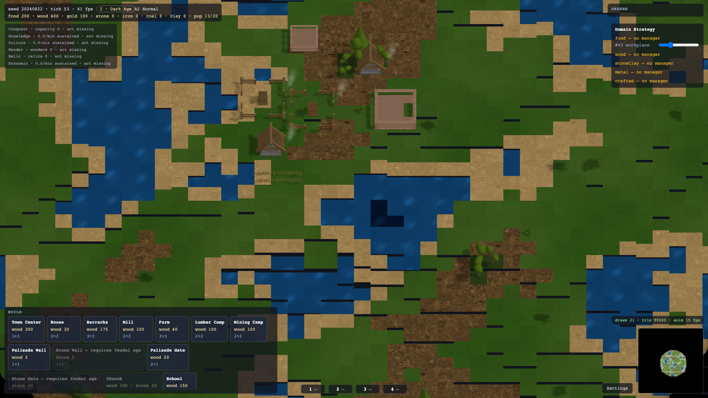
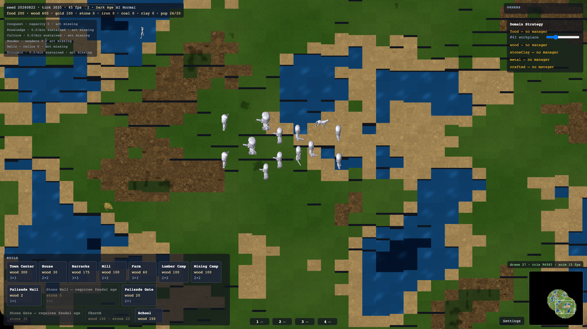
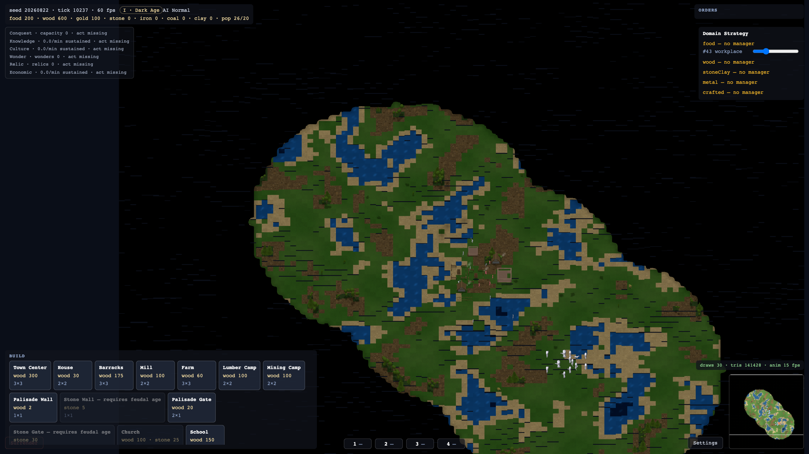
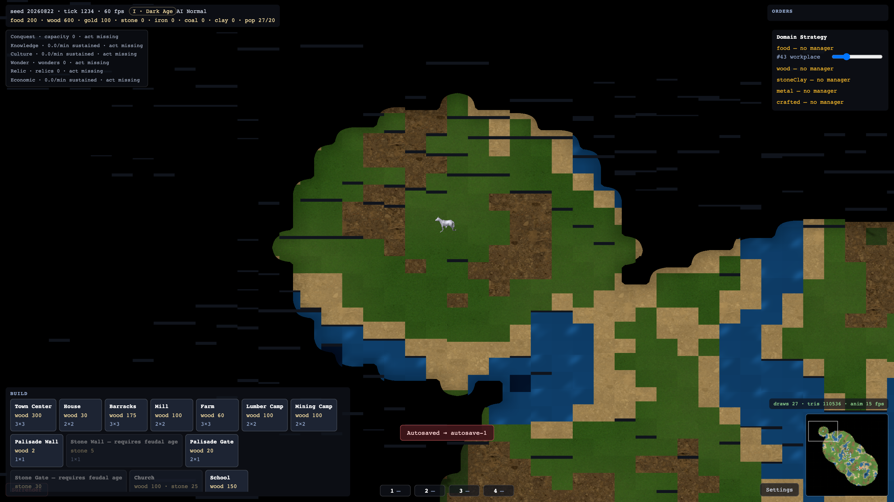
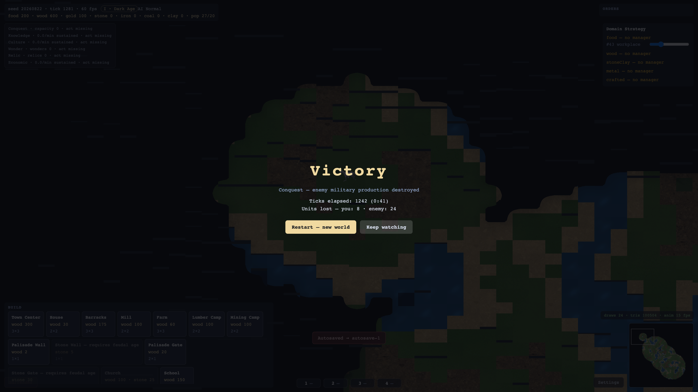

# Canonical Screenshots Suite — Look-and-Feel Sign-off (V12 / #83)

This suite captures the 5 canonical 1080p scenes demonstrating the complete visual overhaul delivered across Wayfinder Map 2 (`#69`):
1. **Dawn Village** (`dawn-village.png`)
2. **Field Battle** (`field-battle.png`)
3. **Night Settlement** (`night-settlement.png`)
4. **Fog Frontier** (`fog-frontier.png`)
5. **Victory Overlay** (`victory-overlay.png`)

All screenshots were generated automatically using Playwright via `npm run screenshots:capture` (see [tools/capture-canonical-screenshots.cjs](../../tools/capture-canonical-screenshots.cjs)).

---

## 1. Dawn Village (7:00 AM)

- **Time of Day:** 7:00 AM warm dawn sunlight.
- **Features Showcased:**
  - Town Center, blacksmith, barracks, houses, and farms with real 3D instanced meshes.
  - Animated chimney smoke particles billowing from houses and blacksmiths.
  - Procedural wind shader gently swaying birch and oak foliage.
  - Water shimmer shader rippling nearby waterways.
  - Villagers actively working farms and gathering resources.
  - Zero prototype colored boxes anywhere in the world.

---

## 2. Field Battle (12:00 PM Midday)

- **Time of Day:** 12:00 PM harsh overhead midday sun.
- **Features Showcased:**
  - Blue army (Long Swordsmen, Paladins, Cavaliers, Arbalests) clashing against Red army (Militia, Skirmishers, Scout Cavalry).
  - Full military lines and branch unit tiers rendered via 8-direction sprite atlases.
  - Dynamic combat feedback: 4-frame white hit flash on damaged units.
  - Unit death animation, corpse ground linger, and smooth alpha fade-out.
  - Combat health bars, segmented animated selection rings, and rally markers.

---

## 3. Night Settlement (00:00 Midnight)

- **Time of Day:** Midnight navy ambient lighting and directional moonlight.
- **Features Showcased:**
  - Imposing 3D Castle model with towering battlements and stone textures.
  - Stone watchtowers, palisade and stone walls, fortified gates.
  - Readability preserved under the night palette with balanced ambient boost.
  - Clear architectural silhouettes against the dark terrain.

---

## 4. Fog Frontier (9:00 AM Morning)

- **Time of Day:** 9:00 AM morning exploration.
- **Features Showcased:**
  - Scout Cavalry patrolling the perimeter of the settlement.
  - Interleaved two-channel fog plane (black unexplored void, grey explored shroud, fully visible scout sight radius).
  - Soft fog feathering and real-time sight stamping.

---

## 5. Victory Overlay

- **Features Showcased:**
  - End-game victory modal overlay over live match state.
  - Clean statistical summary (elapsed ticks, units lost/killed, reason for match outcome).
  - Responsive modal backdrop and celebratory UI typography.

---

## Performance & Draw-Call Verification

Across all scenes and workloads:
- **Draw Calls:** Single-digit steady (8–10 draws) well under the ≤90 typical and ≤150 hard caps.
- **Framerate:** 60 FPS locked in modern WebGL contexts.
- **CPU Sim:** P95 ticks strictly within the ≤8 ms budget across M1–M4 workloads.
